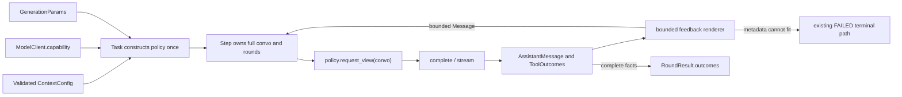

# M17 Runtime Context Engineering 技术设计

## 1. 目标与边界

M17 在现有 `Task -> Step -> ModelClient` 数据链上增加一个有界、可配置且不破坏真实执行历史的上下文策略。它解决三件彼此耦合的问题：长对话历史超出模型窗口、所有工具反馈缺少统一限额、跨 provider 的 prompt cache 命中率口径不一致。

OpenSpec change `runtime-context-engineering` 是行为事实源。本文只裁决实现方式，不扩大需求范围。M17 只实现 sliding window；不实现 importance、summary、hybrid、memory、checkpoint、token stop policy，也不增加策略 registry、factory 或新运行时依赖。

HTTP 只复用共享 Task 核心。请求 schema、响应 schema、鉴权、取消、安全投影、审计降级和精确 allowlist 均保持 M16 契约。

## 2. 总体架构

新增 `src/forgeagent/context.py`，内部按以下顺序组织：

1. `ContextConfig`
2. token estimator 纯函数
3. `ContextPolicy` Protocol
4. `SlidingWindowContextPolicy`
5. feedback limiter 纯函数

`Step` 继续唯一持有完整 conversation 与 rounds。policy 不持有 conversation，不维护游标，也不原地修改消息；每次 provider 调用前根据当前完整 conversation 返回一个新 list。工具反馈进入 conversation 前已经过 limiter，原始 `ToolOutcome` 只保存在 `RoundResult.outcomes` 中。



正常路径由 `Task` 使用 `client.capability`、固定的 `GenerationParams` 和已验证 `ContextConfig` 构造一次 policy，再传给 `Step`。为兼容直接实例化 `Step` 的既有测试和调用点，`context_policy=None` 时由 `Step.__init__` 立即使用相同输入和默认配置构造 policy；不得在 `_run_rounds()` 中懒加载，以保证无效预算在执行前暴露。

## 3. 配置模型与加载

复用 `~/.forgeagent/config.yaml` 顶层 `context` mapping：

```yaml
context:
  utilization_ratio: 0.8
  image_token_reserve: 4096
  tool_result_max_tokens: null
  round_feedback_max_tokens: null
```

`ContextConfig` 是 frozen Pydantic model，仅公开四个字段：

- `utilization_ratio: float = 0.8`，必须满足 `0 < value <= 1`。
- `image_token_reserve: int = 4096`，单位为近似 token，必须为正。
- `tool_result_max_tokens: int | None = None`，单位为近似 token；`null` 表示自适应。
- `round_feedback_max_tokens: int | None = None`，单位为近似 token；`null` 表示自适应。

不公开 estimator 字符权重、message framing 或只有一个合法值的 `strategy`。缺少整个 `context` mapping 时使用上述安全默认值；mapping 存在但字段、类型或范围无效时 fail-closed，不钳制、不回退默认值。

配置对象在 load 时一次性完成 Pydantic 校验。仅当两个 feedback override 都显式提供时，load-time 检查 `round_feedback_max_tokens >= tool_result_max_tokens`；混合 override 要等 policy 解析自适应值后统一验证。

model registry 继续只消费 `groups`。CLI/REPL 同时加载 registry 与 context；reload 先在临时对象中完整验证两者，全部成功后原子替换当前快照。任一失败时保留旧 registry 与旧 context 的完整组合，避免新旧预算假设错位。

HTTP 显式 serve 配置接受同结构的 server-owned `context` mapping，并在 listener bind 前预构造/验证 policy limits。验证错误由现有 `HttpStartupError` 通道呈现。HTTP submit body 仍是严格 schema，客户端不能覆盖 policy、窗口或 feedback 限额。

## 4. Token 估算

估算器完全本地、确定性、零依赖，仅用于保护 context，不用于计费或 cache 指标。

对每条文本按字符类别分别计数：

```text
text_tokens =
    ceil(ascii_alnum_or_space_count / 4)
  + ceil(ascii_punctuation_count / 2)
  + ceil(non_ascii_utf8_byte_count / 2)
```

每条 message 再加 4 tokens framing；每个 request 再加 2 tokens framing。`TextItem` 按同一文本公式估算；每个 `ImageItem` 固定增加 `image_token_reserve`，不得把 base64 data 当作文本逐字符估算。

所有除法使用 `ceil`，使误差方向偏向提前压缩。测试矩阵覆盖英文、中文、混合文本、代码、JSON、emoji、空消息、TextItem 与多图片消息，并证明估算结果只依赖消息内容与配置。

## 5. Policy 初始化与预算

输出预留取本次 Task 生命周期内实际生效值：

```text
O = params.max_output_tokens
    if params is not None and params.max_output_tokens is not None
    else capability.max_output_tokens

input_budget = floor(capability.context_window * utilization_ratio) - O
```

安全利用率先应用于完整 context window，再完整扣除输出预留。该公式比只缩放输入部分更保守，并为 token 估算不足、思考 token 和 provider 差异留出缓冲。

若 `input_budget <= 0`，policy 初始化立即失败。feedback 默认限额在初始化时计算一次并固化：

```text
adaptive_round_limit = floor(input_budget * 0.10)
adaptive_result_limit = floor(adaptive_round_limit * 0.25)
```

显式值覆盖对应自适应值。完成 null/override 解析后，统一验证两个最终整数都大于 0 且 `round_limit >= result_limit`；包括自适应 floor 得到 0、单显式值大于已解析 round limit 等混合场景。失败与其他 policy 初始化错误使用同一结构化配置错误语义。

固定的 8192/2048 不是默认值。它们没有模型窗口尺度或 benchmark 依据；限额随 `input_budget` 自适应，用户仍可用配置显式收紧或放宽。

## 6. Sliding-window 选择算法

Conversation 的前两条消息是不可淘汰前缀：system prompt 与 initial goal。后续历史按完整交互单元分组：一个 assistant message 与紧随其后的 feedback message或 prose nudge 构成一个 round。单个 assistant 发出的多个 ToolCall 及合并反馈不得拆分。

`request_view(convo)` 执行以下步骤：

1. 验证前缀形状并估算不可淘汰前缀。
2. 若前缀超过 `input_budget`，返回本地 context-budget failure；不截断 system/goal，不调用 provider。
3. 将前缀后的消息解析成完整 rounds；不制造孤立 assistant 或 feedback。
4. 从最新 round 向前逐个尝试加入预算，遇到首个无法加入的更旧 round 后停止。
5. 将选中的 rounds 恢复原始顺序，返回新的 message list。
6. 若前缀与最新完整 round 本身仍超过预算，返回本地 context-budget failure；不拆分或改写最新 round。

阈值以下时，返回 list 的消息内容和顺序与原 conversation 完全相同。发生滑动时，只创建新 list；保留的 `Message` 内容不改写，Step 持有的 conversation 与 `RoundResult` 不变。

Policy 在 `_run_rounds()` 每次 `complete()` 或 `stream()` 之前调用。取消检查优先于 policy。所有本地 context failure 必须发生在 LLM operation id 创建和 `llm.attempt started` 审计之前，避免产生没有对应 outcome 的孤立 attempt。

## 7. 统一工具反馈 limiter

### 7.1 ToolOutcome 元数据

`ToolOutcome` 增加两个内部执行字段：

```python
continuation: str | None = None
truncation_mode: Literal["head", "tail"] = "tail"
```

工具在完整执行结束后填写这些字段，不预判最终是否截断。limiter 只有在 detail 实际被截断时才渲染 continuation；未截断时忽略。continuation 经过现有 secret masking，且两个字段都不进入 HTTP 安全投影。

工具语义如下：

| 工具 | mode | continuation 原则 |
| --- | --- | --- |
| Exec | tail | 保留最终状态、异常和退出信息；建议缩小输出或分片执行 |
| FileRead / FileList | head | 保留文件/列表开头；只说明真实可用的缩小路径或其他现有读取方式 |
| WebFetch | head | 保留 preview 开头；仅在完整响应确实已落盘时引用真实相对路径 |
| Survey | head | 保留问题或结果开头；不虚构分页 |
| MCP | head | 固定说明“此工具不保留游标；如需更多结果，请缩小查询参数后重新调用” |

不得为 M17 顺手给 FileRead/FileList/MCP 增加 cursor、offset 或分页协议。

### 7.2 水位分配

limiter 输入完整、按执行顺序排列的 `ToolOutcome`，输出一条有界 feedback 文本。它保留所有 outcome 状态头与原始顺序，并对 detail 使用确定性水位分配：

1. 用同一 estimator 计算每个状态头的固定成本。
2. 先假设 detail 不截断分配预算；当结果需要截断时加入必要 marker、真实 continuation 和极小的数字长度余量。
3. 从 round limit 扣除实际固定成本，给每个 detail 的需求加上 `result_limit` 上限。
4. 在未满足项之间均分剩余预算；短 detail 未使用份额继续分配给长 detail，直到预算耗尽或需求全部满足。
5. 对每个需要截断的 detail，用二分查找求 estimator 允许的最大 head/tail 字符片段。估算关于前缀/后缀长度单调，因此结果确定。
6. marker 集合变化后重新计算固定成本和水位；截断集合只会扩大，最多 `outcome_count + 1` 次收敛。

截断标记必须说明内容不完整、精确可得的原始字符或字节总量、展示范围和真实 continuation。现有 static-analysis feedback 与 `exec_result.dropped_state_keys` 警告也属于 detail payload，必须计入单结果和单轮预算。`dropped_state_keys` 表示 restricted executor 无法跨进程序列化的 runtime state key，不是 Survey `needs_info`。

若状态头、必要 marker 和实际 continuation 的固定成本已经超过 round limit，limiter 不省略已执行工具状态，也不软性超额。当前 `RoundResult` 保留全部原始 outcomes 与既有工具审计，设置 `stopped_reason=Termination.FAILED`，并使用有界 `stopped_detail="feedback metadata exceeds context budget"`；不得构造下一轮 feedback 或调用 provider。

Step conversation 只追加 limiter 产出的有界 feedback message。完整原始 detail 不进入后续 request history，但仍保存在 `RoundResult.outcomes`，供本地任务结果、终态推导和测试使用。

## 8. Usage 与 cache hit rate

`TokenUsage` 增加内部字段：

```python
total_prompt_tokens: int | None = Field(default=None, exclude=True, repr=False)
```

provider adapter 是 normalized denominator 的唯一知识边界：

- Anthropic：`total_prompt_tokens = input_tokens + cached_tokens`；现有 `cached_tokens` 已包含 cache creation 与 cache read。
- OpenAI-compatible：`total_prompt_tokens = input_tokens`；provider 的 prompt/input total 已包含 cached 部分。

成功且 provider 返回正常 usage 的 adapter 单元测试必须断言 denominator 非 `None`；响应确实缺 usage 时允许为 `None`。Step、CLI 与 audit 不按 provider/model 名称分支。

任务或 REPL session 使用累计分子除以累计分母，不平均逐轮比例。只要任一成功调用的 denominator 为 `None`，整个聚合结果永久标为不可用，避免用部分样本产生误导。只有满足 `total > 0` 且 `0 <= cached <= total` 时才计算比例；零分母、缺失或异常原始值均为 CLI `cache_hit=n/a` / audit JSON `null`，不得钳制。

CLI 在现有最终 usage 行追加 task cache hit rate；REPL 沿用 session 累计 usage，但每个 goal 仍创建独立 Task，不继承消息历史。成功 `llm.outcome.parameters.usage` 保留原始字段，并在同级记录 `cache_hit_rate`。HTTP `_usage_summary` 继续精确返回既有四字段，不暴露 rate 或内部 denominator。

## 9. 错误与取消优先级

同一边界出现多个终止条件时按以下顺序处理：

1. cooperative cancellation；取消始终优先。
2. 无效配置或 policy 初始化；执行开始前结构化失败。
3. system + initial goal 超预算；LLM attempt 审计前 `FAILED`。
4. 不可淘汰前缀 + 最新完整 round 超预算；LLM attempt 审计前 `FAILED`。
5. feedback 固定元数据超预算；保留 outcomes/tool audit，当前 round `FAILED`。
6. provider 实际 tokenizer 仍拒绝；沿用 `client_error:invalid_request`，不无限重试。
7. audit sink 写入失败；沿用 fail-open 与 `audit_degraded`。

不新增 `Termination` 值，不创建假的 `ClientError` 或 provider attempt 来表达本地预算失败。

## 10. 实现影响面

- `src/forgeagent/context.py`：配置、估算、policy、窗口选择、feedback limiter。
- `src/forgeagent/models.py`：`TokenUsage.total_prompt_tokens` 内部字段。
- `src/forgeagent/tools.py` 及具体工具：`ToolOutcome` continuation/mode 和真实提示。
- `src/forgeagent/task.py`：构造并注入 policy。
- `src/forgeagent/step.py`：每次请求前取 view；统一 feedback；本地失败与 audit 插入点。
- `src/forgeagent/anthropic_client.py`、`src/forgeagent/openai_compatible_client.py`：填充 normalized denominator。
- `src/forgeagent/cli.py`：配置装配、事务化 reload、task/session cache rate 显示。
- `src/forgeagent/http_config.py`、`src/forgeagent/http_task_service.py`：server-owned context 装配与启动前验证，不改 HTTP schema。

Ponytail 约束：不增加依赖、manager、factory、registry、策略枚举或独立 metrics 传递链。新增 `ContextPolicy` 只因为它隔离了 Step 的请求视图且支持测试注入；其余算法保持纯函数。

## 11. 测试设计

### 11.1 纯函数与配置

- `tests/test_context.py` 覆盖四字段配置、缺失 mapping、无效值、双显式/混合 override、budget 与 adaptive floor 边界。
- 表驱动覆盖英文、中文、代码、JSON、emoji、多模态、framing、ceil 方向与输入不变性。
- 覆盖阈值以下完全一致、淘汰最旧完整 round、ToolCall/feedback 配对、前缀超预算、最新 round 超预算。
- 覆盖水位公平性、短结果归还预算、head/tail 二分、marker 收敛、continuation 脱敏和 metadata overflow。

### 11.2 Step、Task 与 provider

- `tests/test_step.py`、`tests/test_task.py` 分别验证 complete/stream 每次调用都使用 request view，失败发生在 LLM attempt audit 前，原始 outcomes 保留。
- Anthropic/OpenAI-compatible adapter 覆盖 streaming/non-streaming denominator、正常 usage 非 None、缺失 usage。
- `RecordingClient` 证明阈值以下只追加，system 与保留消息逐字稳定；滑动后不改写消息对象。

### 11.3 入口与回归

- CLI task ratio、REPL session ratio、任一缺失 denominator 导致 `n/a`、reload 事务性。
- HTTP 启动前 policy 校验、submit override 拒绝、usage schema snapshot。
- 完整回跑 M16 bearer auth、严格 goal schema、取消、安全投影、审计降级、task correlation、MCP autoApprove 不绕过 allowlist。
- 长对话 mock replay 验证发生滑动与工具截断后任务仍能完成。

最终门禁包括聚焦测试、完整 pytest、Ruff、离线 golden、OpenSpec strict validation 与 `git diff --check`。实际 provider tokenizer 不是离线测试事实；只验证本地估算不变式与 provider error 结构化路径。

## 12. 迁移与回滚

先加入 context 纯函数与测试，再接入 Task/Step，然后统一工具反馈，最后接入 usage/CLI/audit 和 HTTP 装配。阈值以下行为必须在每一阶段保持。

回滚时可移除 policy 注入和 context 配置，恢复 Step 直接发送完整 conversation；`total_prompt_tokens` 是排除序列化的内部字段，不需要数据迁移。原始 `TokenUsage`、TaskOutcome、HTTP endpoint 与响应 schema 均保持兼容。

## 13. 已知取舍

- 近似估算可能提前压缩，也可能仍低估特殊输入；0.8 利用率、完整输出预留和 provider error 路径共同缓解。
- Sliding window 会丢弃旧细节；M17 只保证完整交互边界，不声称提供语义摘要。
- 自适应 feedback 上限随模型窗口增大，避免历史 8192 常量限制大窗口模型；显式配置仍可能被用户设得过大，因此最终仍受 input budget 与完整 round 约束。
- 某些工具没有真实 continuation；诚实说明只能缩小输入或重跑，比虚构可恢复能力更重要。
